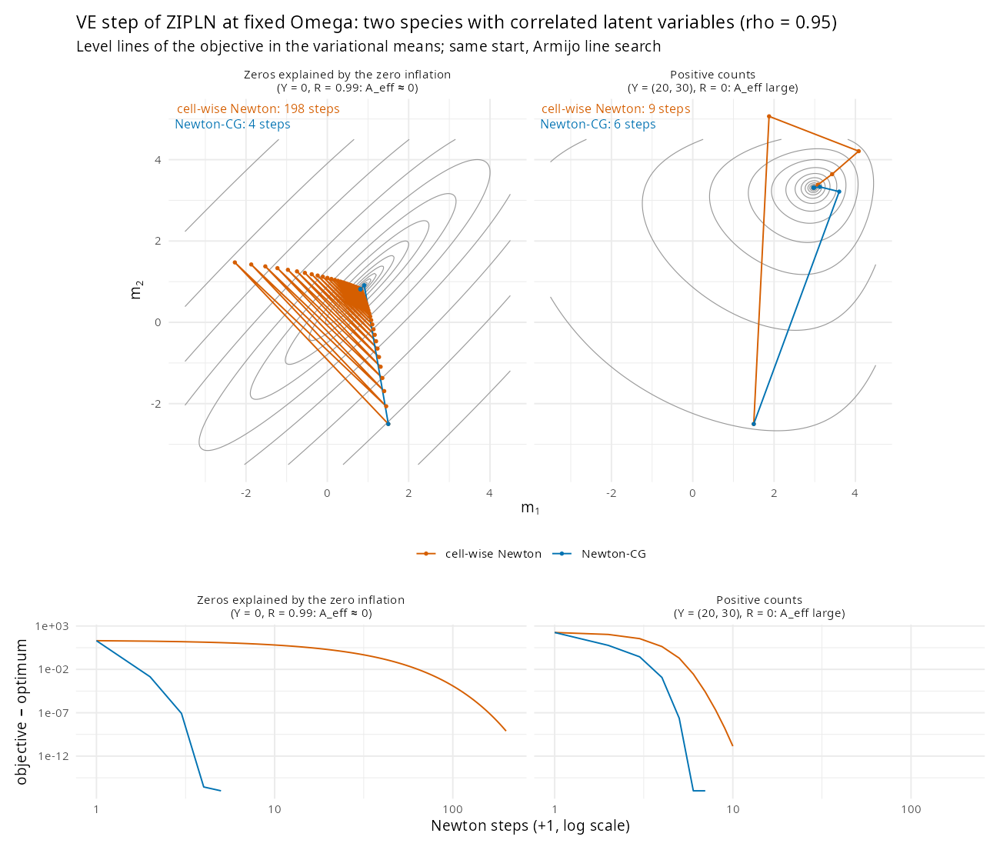

# Convergence of the outer loop of ZIPLN

Scripts behind the SQUAREM acceleration of `ZIPLNfit$optimize()` and the default
`maxit_out = 500` (branch `zipln-convergence`). Cases: `cases.R` (13 real data sets).

- `diagnose.R`, `slow_mode.R`: the loop converges linearly (rates up to 0.996); the slow mode
  is the latent means of the zero counts (EM with much missing information).
- `squarem.R`: prototype of SQUAREM on the state (M, log S2, logit R, B0), with the reference
  optimum of each case (plain iterations to 1e-10, `squarem_adaptive.rds`).
- `profiled.R`, `profiled_R.R`: VE step with Omega and B (and R) profiled, by L-BFGS. Dropped:
  the profiled bound is too ill-conditioned for a first-order solver (no convergence in
  20 000 iterations on barents), the slow mode needs the Newton step of each cell.
- `integrated.R`: SQUAREM as integrated, tolerances 1e-6 to 1e-8.
- `trajectories.R`, `stopping_rules.R`: an extrapolated stopping rule does no better than
  the relative decrease of the objective.
- `baseline.R`, `compare_defaults.R`: candidate defaults against the former ones (maxit_out =
  200, no acceleration); `ftol_out = 1e-6`, `maxit_out = 500` chosen.
- `multistart_check.R`, `abandon_trajectories.R`, `abandon_rules.R`: the two starting points
  with the new defaults; one miss of the abandonment (0.64 on mollusk site|site, the bound
  stalls then improves again), not avoidable by extrapolation.

## VE step by Newton-CG (branch `zipln-newton-cg`)

- `partial_ve.R`: `maxit_ve` 1 or 3 with SQUAREM; much worse (-900 to -1800 on microcosm).
- `freeze.R`, `freeze_both.R`: Omega, pi, or both frozen at convergence; the loop stays slow,
  so the slow mode is inside the VE step (cell-wise 2x2 Newton step, Jacobi-like, blind to the
  coupling through Omega and the profiling of B; stopped early by the relative tolerance).
- `ve_cg.R`: prototype in R of the truncated Newton step, PCG preconditioned by the 2x2
  blocks, on the frozen VE problem (`ve_cg/`, `ve_cg_frozen.rds`): 6 to 35 times fewer products
  by Omega for the same optimum; on microcosm col, 1 000 products against 8 000.
- `ve_cg_outer.R`: Newton-CG VE step solved exactly in the outer loop (`ve_cg_outer.rds`):
  +68 on microcosm col, half the outer iterations, but 2 to 7 times the products.
- `ve_cg_inexact.R`, `ve_cg_ftol7.R`: inexact VE steps (`ve_cg_inexact.rds`,
  `ve_cg_ftol7.rds`): `cg_max = 5`, `ftol_in = 1e-6` the best trade-off; a cap on the Newton
  steps (1 or 3) collapses on microcosm col.
- `bench_cg.R`: `ZIPLN()` in C++, current default against `cg_max = 5` with `ftol_in` 1e-6
  and 3e-7 (`ve_cg/bench_*.rds`). The first run showed that the C++ objective omits
  `sum(log(Y!))`, which makes the relative tolerance up to 250 times looser on microcosm; the
  Newton-CG step tests it on the shifted objective.
- `toy_ve_cg.R`, `toy_ve_cg.png`: a toy illustration of the slow mode, in two dimensions.

### Toy illustration: why the cell-wise step stalls on zeros

The toy problem has one observation and two species whose latent variables are strongly
correlated (ρ = 0.95, σ² = 4). The VE objective in the variational means
m = (m₁, m₂) is drawn with the variational variances and R held fixed:

f(m) = Σⱼ A_eff,j(mⱼ) − Yⱼ mⱼ + ½ (m − μ)ᵀ Ω (m − μ), with A_eff,j = (1 − Rⱼ) exp(oⱼ + mⱼ + sⱼ²/2).

Its Hessian is diag(A_eff) + Ω. The two methods start from the same point and use the same
Armijo line search as the package:

- the **cell-wise Newton step** divides each coordinate of the gradient by the diagonal of
  the Hessian, A_eff,j + Ω_jj, as in the package: it is a Jacobi-like step;
- **Newton-CG** solves the Newton system by at most 5 PCG iterations preconditioned by that
  diagonal (`cg_max = 5`, `cg_tol = 0.1`).

What the two panels show:

- **Positive counts** (Y = (20, 30), R = 0, right panel): A_eff is large and dominates the
  Hessian. The level lines are nearly round, and the cell-wise step converges in 9 steps,
  against 6 for Newton-CG.
- **Zeros explained by the zero inflation** (Y = 0, R = 0.99, left panel): A_eff ≈ 0, and the
  Hessian is Ω itself. Only the coupling through Ω holds the variational means, and the
  cell-wise step ignores it. The level lines form a narrow valley along the diagonal, and
  the cell-wise step bounces from one side to the other, shrinking the error by a factor
  of about |Ω₁₂|/Ω₁₁ = ρ = 0.95 per step. It needs 198 steps. Newton-CG accounts for the
  coupling and converges in 4.

On data such as microcosm, where most cells are zeros, many of them explained by the zero
inflation, this mode dominates. That is why freezing Ω and π leaves the loop just as slow
(`freeze.R`), and why the Newton-CG step pays off.

In the package, the cell-wise step is joint in (m, ψ) for each cell. The profiling of B adds
a second coupling of the same kind, through Q = I − X P_X, which the Newton-CG step also
accounts for.
